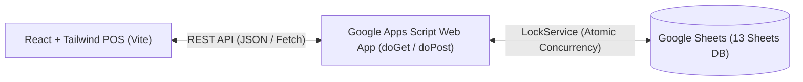

# Deployment & Integration Guide: Google Sheets + Google Apps Script

This guide explains how to deploy the Google Sheets database backend and connect it to the React Point-of-Sale (POS) frontend.

---

## 🏗️ Architecture Overview



---

## 📋 Step 1: Create Your Google Spreadsheet

1. Navigate to **[sheets.new](https://sheets.new)** in your web browser.
2. Set the document title at the top left to:
   ```
   Grocery Store Database
   ```

---

## 💻 Step 2: Open Google Apps Script Editor

1. In the Google Sheets top menu, click **Extensions** > **Apps Script**.
2. Rename the project at top left to:
   ```
   Grocery Store API
   ```

---

## 📄 Step 3: Copy the Three Backend Files

You need to copy three files from the `backend/` folder of this project into the Apps Script editor:

### 1. `Code.gs` (Primary API Router & Concurrency Logic)
- Open the default `Code.gs` in Apps Script.
- Select all text, delete it, and paste the entire contents of [`backend/Code.gs`](file:///d:/Programming/Ali/Grocery%20Store%20Management%20System/backend/Code.gs).

### 2. `Setup.gs` (Database Schema Initializer)
- In the left sidebar of Apps Script, click the **+** (Add a file) icon next to *Files* > Select **Script**.
- Name the file: `Setup` (Apps Script appends `.gs` automatically).
- Paste the entire contents of [`backend/Setup.gs`](file:///d:/Programming/Ali/Grocery%20Store%20Management%20System/backend/Setup.gs).

### 3. `SeedData.gs` (Preloaded Grocery Catalog)
- Click the **+** icon next to *Files* > Select **Script**.
- Name the file: `SeedData`.
- Paste the entire contents of [`backend/SeedData.gs`](file:///d:/Programming/Ali/Grocery%20Store%20Management%20System/backend/SeedData.gs).

### 4. Save
- Press `Ctrl + S` (or click the disk icon) to save all script files.

---

## ⚡ Step 4: Run Initial Database Setup & Seed

1. In the top toolbar of Apps Script, locate the function dropdown (it may show `myFunction` or `doGet`).
2. Select **`setupDatabase`**.
3. Click the **Run** button (▶️).
4. Google will display an **Authorization Required** dialog:
   - Click **Review permissions**.
   - Select your Google account.
   - Click **Advanced** > Click **Go to Grocery Store API (unsafe)**.
   - Click **Allow**.
5. The execution log at the bottom will output:
   ```
   Setup completed successfully! 13 sheets initialized.
   ```
6. Switch back to your Google Sheet tab — you will see all 13 formatted sheets created with emerald green headers!
7. *(Recommended)* Back in Apps Script, select **`seedDemoData`** in the function dropdown and click **Run**. This populates 28+ realistic grocery products (rice, oils, dairy, spices, tea, snacks, bakery, personal care), categories, suppliers, and customers.

---

## 🚀 Step 5: Deploy the Web App

1. At the top right of the Apps Script window, click the blue **Deploy** button > **New deployment**.
2. Click the gear icon ⚙️ next to *Select type* and choose **Web app**.
3. Enter the following settings:
   - **Description**: `Grocery Store API Production v1`
   - **Execute as**: **Me (`your-email@gmail.com`)**  
     *(Important: Ensures the script executes with your permissions to write to your Google Sheet)*
   - **Who has access**: **Anyone**  
     *(Important: Allows the React POS frontend to communicate via Fetch API without Google sign-in popups)*
4. Click **Deploy**.
5. Copy the generated **Web app URL**:
   ```
   https://script.google.com/macros/s/AKfycby.../exec
   ```

---

## 🔗 Step 6: Connect React Frontend

You can connect your Google Sheet endpoint in either of two ways:

### Option A: Via Application Settings UI (No Restart Needed)
1. Launch the React app with `npm run dev`.
2. Open `http://localhost:5173` in your browser.
3. Click **Settings & DB** in the sidebar.
4. Select the **Google Sheets Integration** tab.
5. Paste your Web App URL into the input field.
6. Click **Test Connection** to verify status.
7. Click **Save & Connect Live URL**.

### Option B: Via `.env` File
1. In the project root, create a `.env` file (or copy `.env.example`):
   ```env
   VITE_APPS_SCRIPT_URL=https://script.google.com/macros/s/YOUR_DEPLOYMENT_ID/exec
   ```
2. Restart the Vite development server (`npm run dev`).

---

## 🛡️ Concurrency & Google Sheets Production Best Practices

- **Atomic Concurrency with LockService**: All POS checkouts, stock purchases, and manual inventory adjustments acquire a 30-second script lock (`LockService.getScriptLock()`). If two cashiers scan the last packet of rice simultaneously, one will process and the other will receive a clear "insufficient stock" notification, preventing overselling.
- **Cost Price Snapshotting**: Every sale item captures a snapshot of `costPrice` at the exact time of transaction. Historical Gross Profit and COGS reports remain 100% accurate even if wholesale supplier prices fluctuate later.
- **Data Safety**: Completed sales are never hard-deleted. Returns and cancellations mark transactions as `CANCELLED` and automatically reverse product stock with logged `SALE_RETURN` audit movements.
